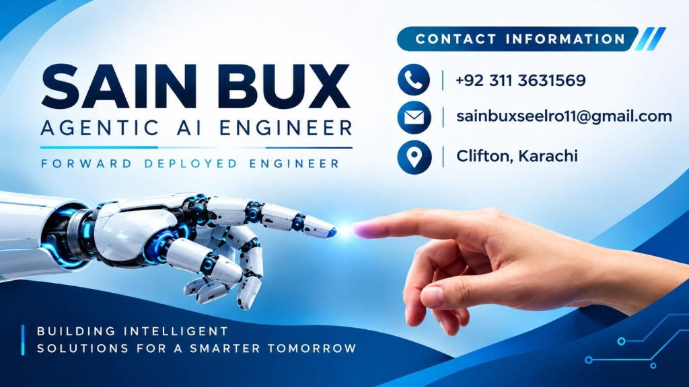

<div align="center">



# 🤖 Autonomous Humanoid Robotics & Physical AI Handbook
### Engineered with an In-Browser Agentic Multi-Agent Control Suite & Live 2D LiDAR Simulator

[](https://sainbux-hadiseelro.github.io/agentic-humanoid-robotics-book/)
[](#-interactive-agentic-mission-console)
[](https://docs.ros.org/)
[](https://developer.nvidia.com/isaac-sim)
[](LICENSE)

<br />

**Authored & Architected by:**  
### **SAIN BUX**
**Agentic AI Engineer • Forward Deployed Engineer**  
📍 Clifton, Karachi • ✉️ [sainbuxseelro11@gmail.com](mailto:sainbuxseelro11@gmail.com) • 📞 [+92 311 3631569](tel:+923113631569)  
*“Building Intelligent Solutions for a Smarter Tomorrow”*

---

</div>

## 📌 Executive Summary

Modern AI is advancing from pure digital language generation to **Physical AI**—intelligent agentic systems that perceive, reason, balance, and act inside 3D physical reality. 

This repository houses an end-to-end, production-grade **Autonomous Humanoid Robotics & Physical AI Engineering Handbook**, equipped with:
- 🎛️ **In-Browser Multi-Agent Orchestration Terminal**: Converts natural language missions into DAG task graphs, zero-shot VLM perception, and real-time ROS 2 actions.
- 🎮 **Live Interactive 2D Robotics Canvas Simulator**: Implements real-time 360° LiDAR raycasting and vector field potential obstacle avoidance directly in the browser.
- 📚 **Comprehensive 4-Module Curriculum**: Covering ROS 2 Humble microservices, URDF kinematics, Gazebo/Unity digital twins, NVIDIA Isaac Sim™ synthetic data generation, and Vision-Language-Action (VLA) foundation models.
- ⚙️ **Automated CI/CD Pipeline**: GitHub Actions for automated type safety, static compilation, and zero-downtime deployment to GitHub Pages.

---

## 🌟 Key Engineering Highlights & Innovations

### 1. 🎛️ Interactive Agentic Mission Console
An interactive multi-agent control suite built right on the front page of the handbook:
- **Planner Agent**: Decomposes high-level instructions (e.g., *"Inspect pipeline valve in Zone 4"*) into an executable DAG task graph.
- **Vision VLM Agent**: Performs multimodal spatial grounding and generates 3D coordinates `[x, y, z]` for target objects.
- **Nav Action Agent**: Computes dynamic humanoid costmaps and dispatches velocity commands to `/cmd_vel`.
- **Safety Critic Agent**: Real-time safety watchdog enforcing hardware torque limits and collision-free envelopes.

### 2. 🎮 Live 2D Autonomous LiDAR Simulator
A real-time robotics simulation running in-browser at 60 FPS:
- Emits **36 dynamic LiDAR laser rays** with distance attenuation.
- **Interactive Obstacle Placement**: Visitors can click anywhere on the canvas to spawn obstacles in real-time.
- **Artificial Potential Field Navigation**: The robot dynamically resolves attraction forces toward the goal and repulsion forces away from obstacles.

### 3. 🦾 4 Core Architectural Modules
```mermaid
flowchart LR
    M1["🦾 Module 01<br><b>ROS 2 & Kinematics</b><br>rclpy, Nodes, URDF"] ──▶ M2["🌐 Module 02<br><b>Digital Twins</b><br>Gazebo & Unity 3D"]
    M2 ──▶ M3["🧠 Module 03<br><b>Isaac Sim & Nav2</b><br>Synthetic Data & VSLAM"]
    M3 ──▶ M4["🎙️ Module 04<br><b>VLA Multimodal AI</b><br>Whisper + LLM Planner"]
```

1. **Module 1: ROS 2 Core & Humanoid Kinematics**
   - Distributed pub/sub architecture (`rclpy`), custom interfaces, services, and complete bipedal URDF/Xacro kinematic chain definitions.
2. **Module 2: Digital Twin Simulation (Gazebo & Unity 3D)**
   - Sim-to-Real zero-risk methodology. Rigid-body physics tuning in Gazebo, high-fidelity photorealistic rendering in Unity, and synthetic LiDAR / depth camera streaming.
3. **Module 3: The AI-Robot Brain (NVIDIA Isaac™ & Nav2)**
   - GPU-accelerated simulation with Omniverse PhysX. Synthetic Data Generation (SDG) with automated ground truth labeling, Isaac ROS VSLAM, and Nav2 bipedal navigation.
4. **Module 4: Vision-Language-Action (VLA) & Voice Autonomy**
   - Natural language voice control with OpenAI Whisper, LLM cognitive task breakdown, multimodal perception, and the Grand Autonomous Humanoid Capstone.

---

## 🛠️ Tech Stack & Tooling

| Domain | Technology / Library | Industry Application |
| :--- | :--- | :--- |
| **Agentic AI & LLMs** | Multi-Agent Swarms, OpenAI Whisper, VLM Models | Goal decomposition, voice-to-action translation, semantic perception |
| **Robotics Middleware** | ROS 2 Humble / Iron, Python (`rclpy`), C++ | Real-time inter-process communication, pub/sub topologies, action servers |
| **Kinematics & Modeling** | URDF, Xacro, TF2 Transforms | Bipedal joint limits, inertial tensors, link transforms |
| **Physics & Digital Twins** | Gazebo Sim, Unity 3D, NVIDIA Isaac Sim™ | Sim-to-real transfer, contact dynamics, photorealistic rendering |
| **Navigation & Autonomy** | Nav2, Costmaps, Artificial Potential Fields | Bipedal obstacle avoidance, path planning, VSLAM |
| **Frontend & UI Platform** | Docusaurus 3, React 19, TypeScript, PostCSS | Interactive handbook, glassmorphic UI, responsive 2D canvas |
| **Automation & DevOps** | GitHub Actions, Git, npm, Node.js 20 | Automated CI/CD, TypeScript quality gates, GitHub Pages deploy |

---

## ⚡ Quickstart & Local Execution

Get the entire handbook and interactive simulation suite running locally in under **60 seconds**:

### Prerequisites
- [Node.js](https://nodejs.org/) v20.0 or higher
- Git

### 1. Clone the Repository
```bash
git clone https://github.com/SainBux-HadiSeelro/agentic-humanoid-robotics-book.git
cd agentic-humanoid-robotics-book
```

### 2. Install Dependencies
```bash
# From root directory:
npm --prefix frontend_book install
```

### 3. Launch Development Server
```bash
# Run directly from root:
npm run dev
```

Visit **`http://localhost:3000/agentic-humanoid-robotics-book/`** in your browser to explore the handbook, test the mission console, and play with the autonomous simulator!

---

## 🧪 Quality Assurance & Type Safety

This codebase enforces strict type safety and static validation:

```bash
# Run TypeScript typechecker (0 errors enforced)
npm run typecheck

# Compile production static distribution
npm run build
```

---

## 🚀 Automated CI/CD Pipeline

Every push to `main` triggers our GitHub Actions automation workflow ([`.github/workflows/ci-cd-deploy.yml`](.github/workflows/ci-cd-deploy.yml)):
1. Checks out repository with full history.
2. Sets up Node.js 20 environment with caching.
3. Runs automated **TypeScript 0-Error Quality Gate**.
4. Compiles client & server static assets.
5. Deploys production bundle directly to the `gh-pages` branch.

---

## 💼 About the Author & Availability

**Sain Bux** is an **Agentic AI Engineer & Forward Deployed Engineer** specializing in bridging artificial intelligence with physical robotic systems, autonomous agent swarms, and simulation pipelines.

- 📞 **Phone**: [+92 311 3631569](tel:+923113631569)
- ✉️ **Email**: [sainbuxseelro11@gmail.com](mailto:sainbuxseelro11@gmail.com)
- 📍 **Location**: Clifton, Karachi, Pakistan
- 🌐 **Specialties**: Agentic AI, Autonomous Robotics (ROS 2), Digital Twins (Gazebo/Unity), NVIDIA Isaac Sim, Multimodal VLA.

> 🤝 **Open for Opportunities**: Available for Full-Time Roles, Forward Deployed Engineering, High-Impact Consulting, and Collaborative Physical AI Projects.

---

<div align="center">
  <sub>Copyright © 2026 Sain Bux. Built with ❤️ for the Global Robotics & AI Community.</sub>
</div>
