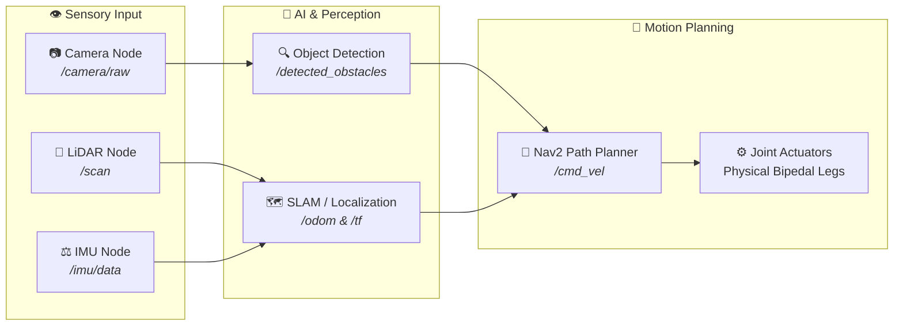

# 📐 Visual System Architecture: ROS 2 Flowcharts

:::tip 🧠 See the Whole Picture
Text can describe code, but diagrams show the flow of energy and information. Here is the visual blueprint of how a ROS 2 autonomous robot processes the world in real time.
:::

---

## 1. 🌐 The Distributed Node Graph

Unlike traditional monolithic software, ROS 2 divides computation across specialized nodes connected by named topics:



---

## 2. 🧱 The Software Stack: Where ROS 2 Sits

Think of ROS 2 as the **operating system for robotics hardware**:

```
┌─────────────────────────────────────────────────────────────┐
│ 🧠 AI Applications (Object Detection, LLM Task Planners)   │
├─────────────────────────────────────────────────────────────┤
│ ⚡ ROS 2 Middleware Layer (Nodes, Topics, Services, TF2)    │
├─────────────────────────────────────────────────────────────┤
│ 🌐 Data Distribution Service (DDS: FastDDS / CycloneDDS)    │
├─────────────────────────────────────────────────────────────┤
│ 🐧 Operating System (Ubuntu Linux 22.04 LTS / Real-Time RT) │
├─────────────────────────────────────────────────────────────┤
│ 🦾 Physical Hardware (Motor Inverters, GPUs, LiDAR Sensors) │
└─────────────────────────────────────────────────────────────┘
```

:::info 💡 Why DDS (Data Distribution Service)?
DDS is an industrial military-grade communications protocol. It guarantees that if a camera sends 30 frames a second, packets arrive with sub-millisecond latency and zero packet collision.
:::

---

## 3. 🎯 The 4 Core Architectural Principles

1. **Decentralized Execution**: If the speech recognition node crashes, your robot's balance node keeps running. The robot never collapses.
2. **Language Agnostic**: Run performance-critical kinematics algorithms in **C++** while writing high-level cognitive AI in **Python**.
3. **Multi-Computer Distributed**: A low-power Raspberry Pi on the robot's chest can read sensors, while an NVIDIA GPU in the backpack runs deep neural networks!
4. **Hardware Agnostic**: Run the exact same node on a physical \$200,000 humanoid robot or inside a zero-cost Gazebo simulator!

---

:::info 🚀 Ready for Hands-On Practice?
**Click the Next Chapter button below** to test your knowledge with interactive exercises!
:::