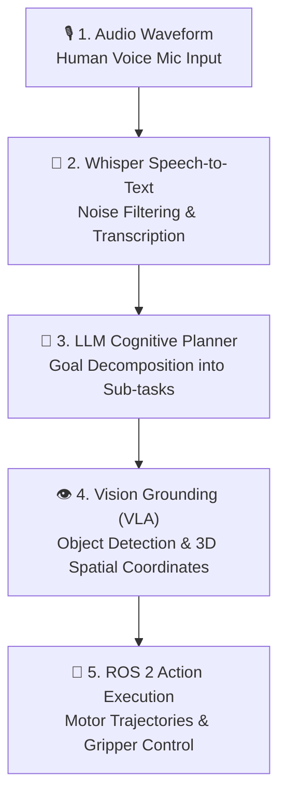

# 🎙️ Voice-to-Action: Speech Recognition & VLA

:::tip 🧠 The Physical AI Holy Grail
*"Robots shouldn't need a joystick or keyboard. You should be able to speak to them naturally, and they should understand the context, plan the steps, and execute the physical motion."*
:::

Welcome to **Module 4: Vision-Language-Action (VLA)**. Here, we connect state-of-the-art multimodal AI models directly to robotic actuators.

---

## ⚡ The Voice-to-Action Mental Pipeline

When you say: *"Robot, grab the green apple from the table and bring it to me"*, the robot executes a 5-stage transformation:



---

## 🔬 How the Stages Work Together

### 1. Audio Capture & Whisper STT
Raw microphone audio is captured at 16 kHz and passed into OpenAI's Whisper model. Whisper is robust against background warehouse noise, robot motor hum, and diverse accents.

```python
# Quick conceptual snippet of Whisper in ROS 2
import whisper

model = whisper.load_model("base")
result = model.transcribe("voice_command.wav")
print(f"Heard: '{result['text']}'")
# Output: "Heard: 'Navigate to charging station'"
```

### 2. Cognitive Task Decomposition (LLM)
Natural speech is ambiguous. A prompt like *"Clean the kitchen counter"* cannot be sent directly to a motor!
The LLM converts high-level instructions into concrete ROS 2 sub-goals:

```json
{
  "original_prompt": "Clean the kitchen counter",
  "plan": [
    {"action": "NAVIGATE_TO", "target": "kitchen_counter", "pose": [2.4, 1.2, 0.0]},
    {"action": "DETECT_OBJECTS", "classes": ["cup", "trash", "plate"]},
    {"action": "PICK_AND_PLACE", "object": "cup", "destination": "sink"},
    {"action": "WIPE_SURFACE", "bounds": [0.5, 1.0]}
  ]
}
```

### 3. Spatial Vision-Language Grounding
The robot's RGB-D camera detects where the "green apple" actually is in 3D space `(X, Y, Z)` relative to the robot's base coordinate frame (`base_link`).

### 4. ROS 2 Action Execution
The plan is dispatched to ROS 2 Action Servers (`NavigateToPose`, `FollowJointTrajectory`, `GraspObject`) with real-time feedback and preemption if an obstacle appears.

---

## 🎯 What You Will Build in This Module

1. **Chapter 1: Voice Recognition with Whisper**
   - Stream audio from a USB mic directly into a ROS 2 node.
   - Run local Whisper inference with real-time text publishing.
2. **Chapter 2: LLM Cognitive Planning & Vision Processing**
   - Feed camera frames + user commands into multimodal vision-language models.
   - Generate collision-free manipulation trajectories.
3. **Chapter 3: The Grand Capstone — Autonomous Humanoid**
   - Complete end-to-end mission: A voice command triggers speech recognition, room navigation, object detection, grasping, and delivery!

---

### 👉 Start Building:
Proceed to [**Speech Recognition Fundamentals →**](/docs/chapter-1-voice-to-action/speech-recognition)