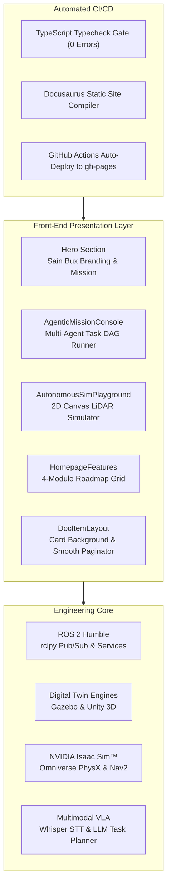

# Technical Architecture & Implementation Plan: Premium UI Branding & Agentic Suite

**Feature Branch**: `006-premium-ui-branding`  
**Feature Lead**: Sain Bux (Agentic AI Engineer)  
**Status**: Completed  
**Technology**: React 19, TypeScript, Docusaurus 3.9, PostCSS, Canvas API, GitHub Actions CI/CD  

---

## 1. Architecture Overview

---

## 2. Component Design & Responsibilities

### 2.1 `AgenticMissionConsole`
- **Purpose**: Demonstrate live multi-agent cognitive planning in-browser.
- **Workflow**:
  1. Accepts high-level goal in natural language.
  2. `PLANNER_AGENT` computes Directed Acyclic Graph (DAG) task breakdown.
  3. `VISION_VLM_AGENT` returns simulated 3D spatial bounding box.
  4. `NAV_ACTION_AGENT` formats and dispatches ROS 2 `/cmd_vel` message.
  5. `SAFETY_CRITIC` verifies dynamic bounds and logs success telemetry.

### 2.2 `AutonomousSimPlayground`
- **Purpose**: Interactive proof-of-work showcasing obstacle avoidance algorithms.
- **Algorithm**:
  - Continuous 360° LiDAR raycasting (36 rays at 10° delta).
  - Ray-to-circle intersection tests with dynamic obstacles.
  - Attraction vector toward waypoint + Artificial Potential Field repulsion from nearest obstacles.
  - Interactive click listener to drop dynamic obstacles anywhere in the arena.

### 2.3 `DocItemLayout` & Reading Experience
- **Purpose**: Deliver an elite, distraction-free reading surface matching Sain Bux's Navy & Cyan brand card.
- **Visuals**:
  - `articleCard`: 2px cyan border (`rgba(0, 210, 255, 0.35)`), rounded corners, left vertical gradient accent spine.
  - Integrated `DocItemPaginator`: Automated `metadata.next` and `metadata.previous` calculation for seamless single-click chapter transitions.

---

## 3. Brand Identity & Style Tokens

| Token | Hex Value | Application |
| :--- | :--- | :--- |
| `--sain-navy-primary` | `#002B49` | Primary headings, buttons, hero accents, footer |
| `--sain-cyan-neon` | `#00D2FF` | Neon glow, borders, interactive pills, LiDAR rays |
| `--sain-blue-accent` | `#0077B6` | Secondary links, subheadings, topic tags |
| `--ifm-background-color` | `#FFFFFF` / `#021324` | Clean crisp background with radial wave overlays |
| `--font-heading` | `'Outfit', 'Montserrat'` | Bold geometric typography with tracked uppercase labels |

---

## 4. Verification & Deployment Strategy

- **Local Validation**: `npm run typecheck` + `npm run build`
- **Automated Validation**: GitHub Actions workflow verifies zero errors on PR and pushes to `main`.
- **Hosting Target**: GitHub Pages at `/<projectName>/`.
